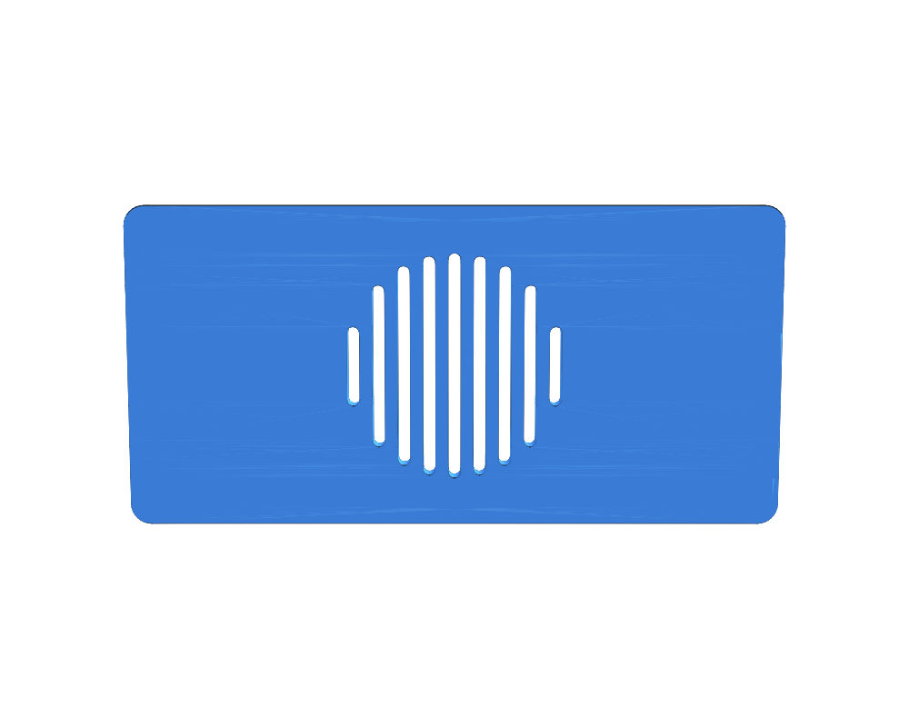

# Bluetooth Adapter Box

## Overview

Small box for a Bluetooth adapter with a separate push-fit lid. The lid has a lip that slides into the box opening and holds by friction.

## Geometry

- Clear inner space: `46 x 21 x 8 mm` (free all the way to the bottom of the lid lip)
- Wall, floor and lid plate thickness: `1.5 mm`
- Box outside: `49 x 24 x 12 mm` (rounded outer corners, R1.5; inner corners stay square)
- Lid: `49 x 24 x 1.5 mm` plate with a `2.5 mm` deep, `1.4 mm` thick lip
- Push-fit: lip outside `46.1 x 21.1 mm` (nominal `-0.05 mm` per side). A first print with `0.15 mm` clearance had about `0.5 mm` total play, so the lip was made `0.4 mm` wider in X and Y
- Lid grille (speaker-style): 9 parallel slots, `1 mm` wide with rounded ends and `0.9 mm` bars, cut within a `Ø17 mm` circle in the middle of the lid; slot lengths `6.0 / 12.2 / 15.1 / 16.5 / 17.0 / 16.5 / 15.1 / 12.2 / 6.0 mm`
- Closed size: `49 x 24 x 13.5 mm`
- Rectangular hole in one short wall: `10 mm` wide, `4 mm` high, bottom edge level with the inner floor (1.5 mm above the bottom face), centered horizontally
- Round hole `Ø6 mm` in the long wall to the right of that short wall (counterclockwise seen from above): circle touches the inner floor, center `15 mm` from the inner face of the short wall with the rectangular hole
- The box is `2.5 mm` taller than wall + 8 mm, so the lid lip does not take space from the 8 mm inner height

All dimensions are `const` values at the top of the `.jscad` file. If the lid is too tight or too loose on your printer, change `FIT_CLEARANCE` (lower = tighter, higher = looser; `0.1` changes the lip by `0.2 mm` overall).

The holes are set by `SLOT_WIDTH`, `SLOT_HEIGHT`, `ROUND_HOLE_DIAMETER` and `ROUND_HOLE_OFFSET`; the grille by `GRILLE_DIAMETER`, `GRILLE_SLOT_WIDTH` and `GRILLE_SLOT_PITCH` (the number of slots and their lengths follow from those).

Print both parts flat: the box with its opening up, the lid with its plate on the bed and the lip up. No supports needed.

## Source

- JSCAD: [`bluetooth-adapter-box.jscad`](./bluetooth-adapter-box.jscad) — parameter `part`: `print` (box + lid side by side), `box`, `lid`, `assembled`
- PNG render script: [`render-png.js`](./render-png.js)
- OpenJSCAD: [Open `bluetooth-adapter-box.jscad`](https://openjscad.xyz/v3/#https://raw.githubusercontent.com/sponnet/ai-3d-designs/refs/heads/main/designs/bluetooth-adapter-box/bluetooth-adapter-box.jscad)

Regenerate the outputs:

```bash
cd designs/bluetooth-adapter-box && jscad bluetooth-adapter-box.jscad --part box -o box.stl && jscad bluetooth-adapter-box.jscad --part lid -o lid.stl && jscad bluetooth-adapter-box.jscad -o bluetooth-adapter-box.stl && node render-png.js
```

## Outputs

- STL box: [`box.stl`](./box.stl)
- STL lid: [`lid.stl`](./lid.stl)
- STL box + lid (print layout): [`bluetooth-adapter-box.stl`](./bluetooth-adapter-box.stl)
- PNG previews: [`bluetooth-adapter-box.png`](./bluetooth-adapter-box.png), [`box.png`](./box.png), [`lid.png`](./lid.png), [`lid-outside.png`](./lid-outside.png), [`assembled-section.png`](./assembled-section.png)

## Preview





