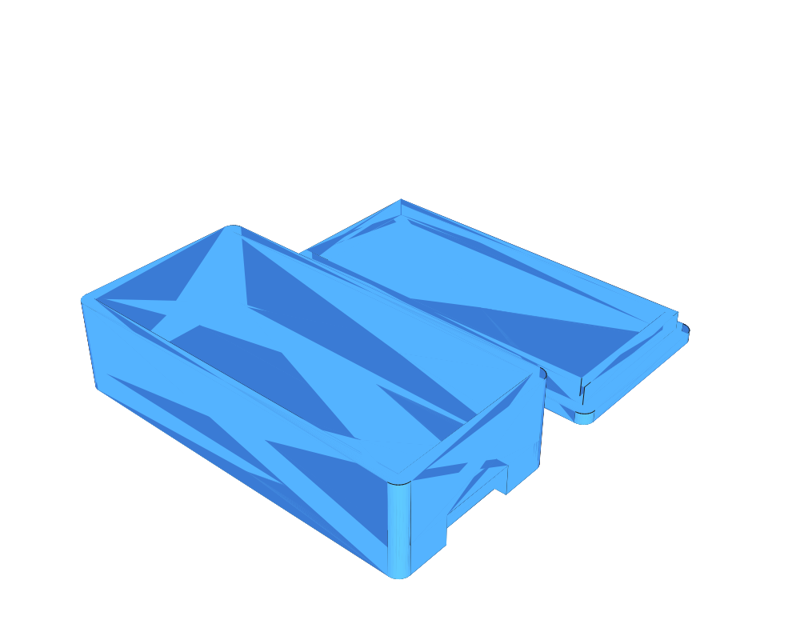
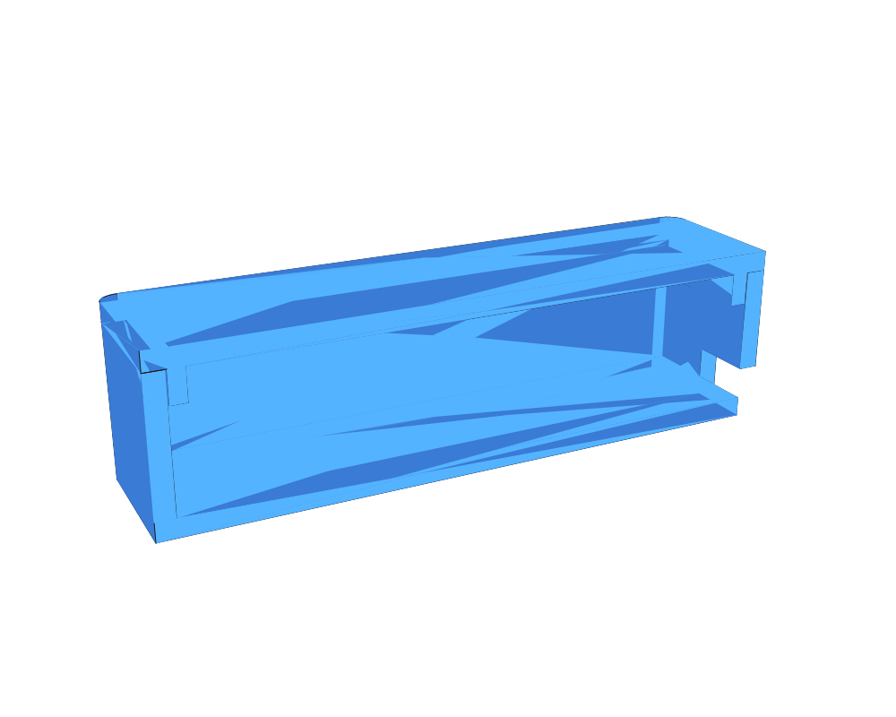

# Bluetooth Adapter Box

## Overview

Small box for a Bluetooth adapter with a separate push-fit lid. The lid has a lip that slides into the box opening and holds by friction.

## Geometry

- Clear inner space: `46 x 21 x 8 mm` (free all the way to the bottom of the lid lip)
- Wall, floor and lid plate thickness: `1.5 mm`
- Box outside: `49 x 24 x 12 mm` (rounded outer corners, R1.5; inner corners stay square)
- Lid: `49 x 24 x 1.5 mm` plate with a `2.5 mm` deep, `1.2 mm` thick lip
- Push-fit clearance: `0.15 mm` per side (lip outside `45.7 x 20.7 mm`)
- Closed size: `49 x 24 x 13.5 mm`
- Rectangular hole in one short wall: `10 mm` wide, `4 mm` high, starting at the bottom face (open to the bottom), centered horizontally
- The box is `2.5 mm` taller than wall + 8 mm, so the lid lip does not take space from the 8 mm inner height

All dimensions are `const` values at the top of the `.jscad` file. If the lid is too tight or too loose on your printer, change `FIT_CLEARANCE` (e.g. `0.1` for tighter, `0.2` for looser).

The hole is set by `SLOT_WIDTH` and `SLOT_HEIGHT`.

Print both parts flat: the box with its opening up, the lid with its plate on the bed and the lip up. No supports needed.

## Source

- JSCAD: [`bluetooth-adapter-box.jscad`](./bluetooth-adapter-box.jscad) — parameter `part`: `print` (box + lid side by side), `box`, `lid`, `assembled`
- PNG render script: [`render-png.js`](./render-png.js)
- OpenJSCAD: [Open `bluetooth-adapter-box.jscad`](https://openjscad.xyz/v3/#https://raw.githubusercontent.com/sponnet/ai-3d-designs/refs/heads/main/designs/bluetooth-adapter-box/bluetooth-adapter-box.jscad)

Regenerate the outputs:

```bash
cd designs/bluetooth-adapter-box && jscad bluetooth-adapter-box.jscad --part box -o box.stl && jscad bluetooth-adapter-box.jscad --part lid -o lid.stl && jscad bluetooth-adapter-box.jscad -o bluetooth-adapter-box.stl && node render-png.js
```

## Outputs

- STL box: [`box.stl`](./box.stl)
- STL lid: [`lid.stl`](./lid.stl)
- STL box + lid (print layout): [`bluetooth-adapter-box.stl`](./bluetooth-adapter-box.stl)
- PNG previews: [`bluetooth-adapter-box.png`](./bluetooth-adapter-box.png), [`box.png`](./box.png), [`lid.png`](./lid.png), [`assembled-section.png`](./assembled-section.png)

## Preview




