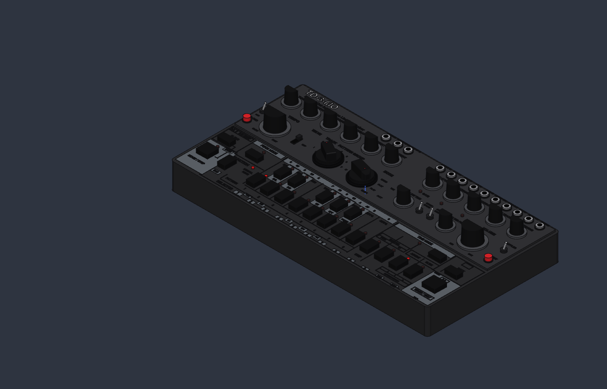
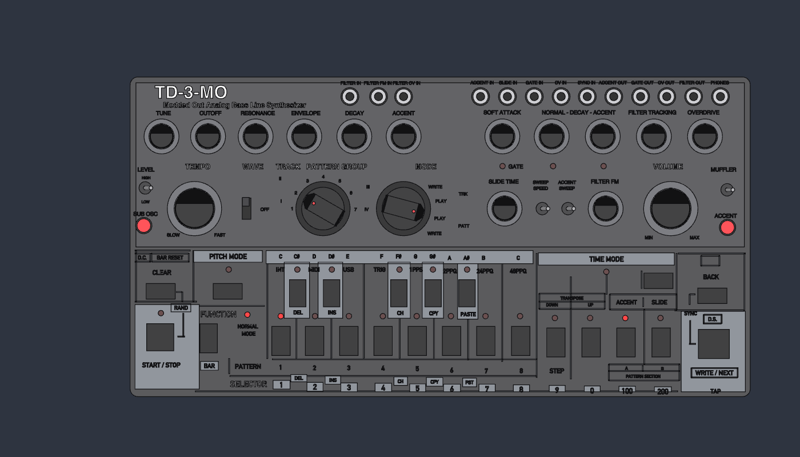

# TD-3-MO

## Overview

Visual model of a Behringer TD-3-MO ("Modded Out Analog Bass Line Synthesizer"), built in [SolidCraft](https://solidcraft.io) from photos of the real unit. It is a look-alike for renders, not a printable or dimensionally exact part: positions come from a top-down photo with a simple perspective correction, so controls can be a few mm off.

[**Open in SolidCraft (browser)**](https://solidcraft.io/app?open=https%3A%2F%2Fraw.githubusercontent.com%2Fsponnet%2Fai-3d-designs%2Frefs%2Fheads%2Fmain%2Fdesigns%2Ftd3-mo%2Ftd3-mo.sc) — opens the design as an unsaved copy, with its full history.

## Geometry

- Chassis `320 x 165 x 32 mm` with R4 vertical corners; the upper (knob) panel is a `2 mm` raised plate, the lower (button) panel is the chassis top
- 17 rotary knobs:
  - 15 round knobs: skirt, slightly tapered cap with a flat top and a 45° bevel facet on the pointer side, red pointer line down the side under the facet (all set to 12 o'clock)
  - Track/Pattern Group and Mode (detented): round base in a dark well with a flat-topped bar whose nose is chamfered; they point at about 10 and half past 3 o'clock, as in the photos
- 13 jacks (nut, silver collar, dark hole), 31 push buttons (incl. red Sub Osc and Accent), 4 toggle switches, the Wave slide switch and 27 LEDs (Function, Pattern 1 and Section A lit)
- Panel graphics: grey fields (Pitch Mode, note-name bar and black-key columns, Time Mode, Start/Stop and Write/Next areas, selector tabs), frames and divider lines as `0.15–0.2 mm` raised bodies
- 143 labels as `0.2 mm` raised text: Helvetica on the upper panel, DIN Alternate Bold on the lower panel; light grey on the dark panel, dark on the grey fields

Every part is its own body (about 900, most of them single letters), grouped in the browser as *Labels upper panel*, *Labels lower panel* and *Panel graphics lower*. The model is about `184k` triangles, under SolidCraft's render limit of `262,144`.

Not modelled: knurling on the knobs, the smiley logo, the note symbols in the Time Mode area, rounded corners on the panel frames.

## Source

- SolidCraft design: [`td3-mo.sc`](./td3-mo.sc)

## Outputs

- Isometric view: [`td3-mo-iso.png`](./td3-mo-iso.png)
- Top view: [`td3-mo-top.png`](./td3-mo-top.png)

